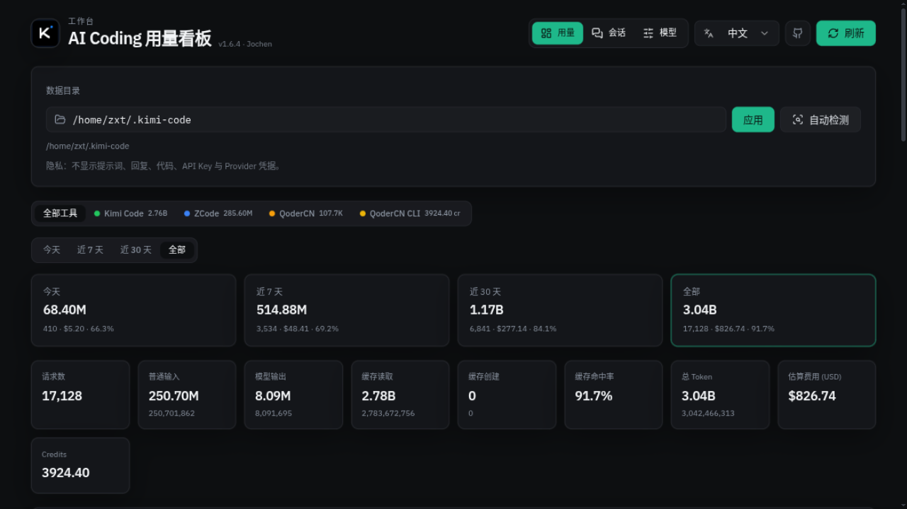

# DoraMonitor

[](./LICENSE)
[](https://nodejs.org/)

[English](./README.md) · **简体中文**

本地、隐私优先的 AI 编码工具用量看板。统一展示 Token、API 刊例价等效费用、缓存命中率、额度窗口、会话与多设备用量，同时提供 Web UI 和命令行。



## 支持的工具

| 工具 | 本地数据源 | 统计内容 |
| --- | --- | --- |
| Kimi Code | `~/.kimi-code/sessions/**/wire.jsonl` | Token、费用、5h/周额度 |
| Codex | `~/.codex/sessions/**` 与归档 rollout | Token、费用、额度快照 |
| Claude Code | `~/.claude/projects/**/*.jsonl` | Token、费用 |
| Oh My Pi（omp） | `~/.omp/agent/sessions/**`（兼容旧 `~/.pi/agent`） | Token、费用 |
| Gemini CLI | Gemini 设置与 OpenTelemetry 导出 | Token、工具事件 |
| ZCode | `~/.zcode/cli/db/db.sqlite` | Token |
| QoderCN IDE | QoderCN `local.db` | Token |
| QoderCN CLI | `~/.qoder-cn/projects/**/*.jsonl` | Credits |
| dsh | `~/.dsh/sessions/**` | Token、费用 |

某个工具不存在或数据损坏时，不影响其他工具。SQLite 均以只读方式打开。

## 环境要求

- Node.js **18+**，推荐 **22.5+** 以获得内置 SQLite 和 zstd 支持。
- 旧版 Node 读取 ZCode/QoderCN 时需要 `sqlite3` CLI；压缩会话使用包内 `fzstd` 回退。
- 不需要数据库服务、Rust 工具链或管理员权限。

## 安装与启动

```bash
npm install -g doramonitor
doramonitor
```

访问 <http://127.0.0.1:3847>。npm 包已包含构建好的 Web UI，无需手动构建。

源码运行：

```bash
git clone https://github.com/DoraJasmine/DoraMonitor.git
cd DoraMonitor
npm ci
npm run build
npm start
```

前端开发使用 `npm run dev`，会同时启动 API 和 Vite 热更新。

## 静默启动与 Windows 自启

```bash
doramonitor web --background --no-open
```

Windows 也可双击 `scripts/start-windows.bat`。脚本使用相对路径，移动安装目录后仍可使用；重复执行会检测已有端口，不会重复启动。

注册登录自启、隐藏窗口和崩溃自动重启：

```powershell
powershell -ExecutionPolicy Bypass -File scripts/register-autostart.ps1
```

Windows 一键安装器仅从 nodejs.org 与 npm 官方源下载，不包含私人同步配置：

```powershell
powershell -ExecutionPolicy Bypass -File scripts/install-windows.ps1 -WithWeb -Start
```

默认仅监听本机回环地址。修改监听地址前请阅读[部署与故障排查](./docs/deployment.md)。

## 命令行

```text
doramonitor [web]                 启动 Web 看板
doramonitor web -d --no-open     后台启动且不打开浏览器
doramonitor status                输出单行用量摘要
doramonitor daemon                状态缓存与周期同步守护进程
doramonitor sync                  立即同步
doramonitor tools                 列出检测到的工具和数据目录
doramonitor stop                  停止 daemon
doramonitor --help                查看全部参数
```

## 主要功能

- 今天、近 7 天、近 30 天和全部用量，模型统计、趋势图与年度热力图。
- 普通输入、输出、缓存读取、缓存写入 Token 及各模型缓存命中率。
- 官方定价链接、自定义价格、USD/CNY 展示与内部统一人民币账本。
- Kimi/Codex 官方额度窗口，以及明确标注为推测值的等效额度估算。
- 跨客户端模型归属：omp 中的 GPT/Kimi 用量可参与对应额度估算，其他模型不会混入。
- `/quota` 页提供客户端限定开关、手动测算、长程估算、区间实际用量和完整历史。
- Kimi 会话与工作区管理，安全预览会脱敏疑似凭据。
- 可选 SSH/WebDAV 多设备同步，包含用于额度估算的一分钟 Token 桶。

等效额度与 API 刊例价金额都不是厂商账单，也不代表官方承诺的套餐上限。

## 隐私

只读取模型、时间、Token 等用量元数据，不读取提示词、回复、代码或 Provider 凭据。服务默认绑定 `127.0.0.1`，不开放 CORS。多设备上传必须显式配置才会启用。详见[隐私与安全](./docs/privacy.md)。

## 文档

- [文档中心](./docs/README.md)
- [架构](./docs/architecture.md)
- [工具数据源](./docs/tools.md)
- [配置](./docs/configuration.md)
- [计价](./docs/pricing.md)
- [额度估算](./docs/quota-capacity-estimation.md)
- [部署](./docs/deployment.md)
- [npm 发布检查](./docs/release.md)
- [开发指南](./docs/development.md)

## 验证与贡献

```bash
npm test
npm run build
npm pack --dry-run
```

CI 在 Ubuntu、Windows 和 Node 18/22 组合上执行相同检查。新增工具采集器的约定见[开发指南](./docs/development.md)。

## 许可证与来源

MIT。本项目由 [kimicode-dashboard](https://github.com/JochenYang/kimicode-dashboard) 二次开发并进行了大量重构。保留 Jochen 原版权与 MIT 许可；DoraMonitor 版权及来源说明见 [LICENSE](./LICENSE) 和 [NOTICE](./NOTICE)。
