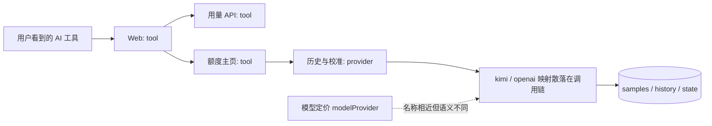
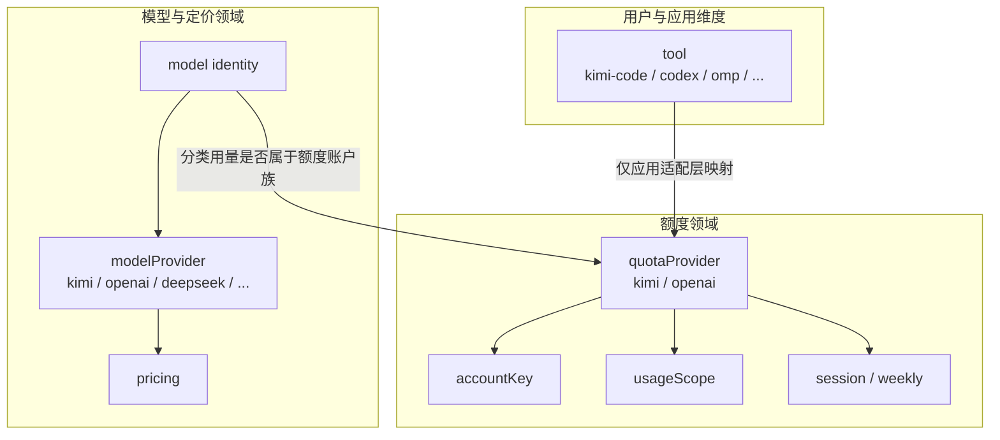
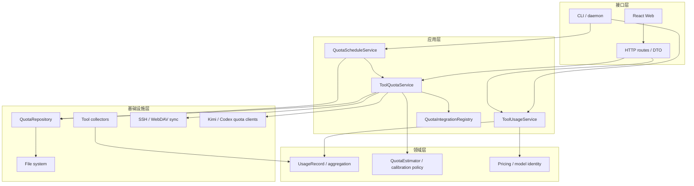
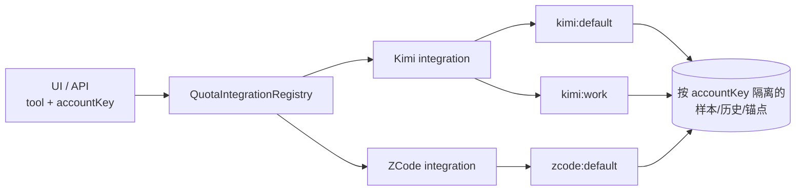
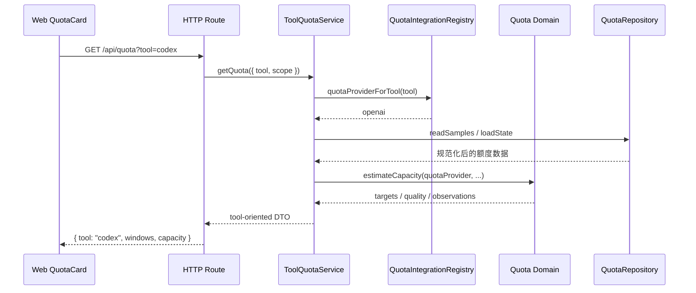
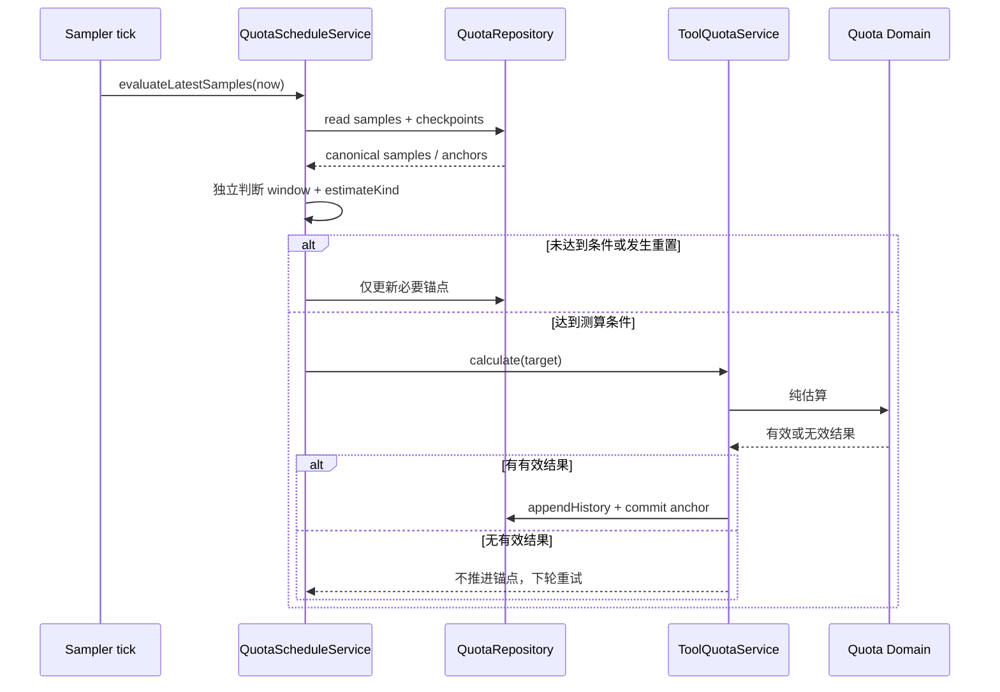
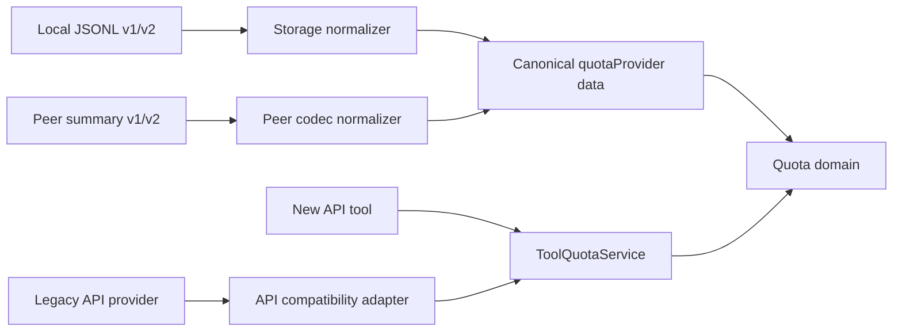
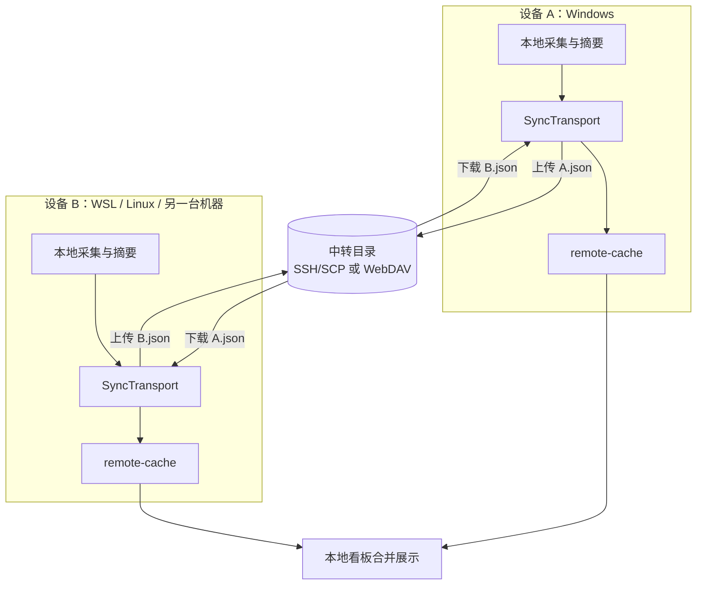

# DoraMonitor 高内聚低耦合架构重构方案

> 状态：v1.0 设计草案，依据 [项目需求文档](./product-requirements.md)。
> 数据字段、迁移与回滚详见 [数据兼容迁移方案](./data-migration-plan.md)。
> 本文描述目标边界和分阶段路径，不表示目录已经调整，也不要求一次性完成所有移动。
> 实施进度：P1 契约测试与 P2 tool 边界首轮已落地；P3 存量存储迁移尚未开始。

## 1. 设计目标与核心决策

### 1.1 目标

1. 用户视角、前端、公开 API 和应用服务统一按 `tool` 分类；
2. 额度账户族只在额度领域中使用 `quotaProvider`；
3. 模型厂商只在模型身份、定价和配置中使用 `modelProvider`；
4. 领域算法不依赖 HTTP、React、文件系统或网络；
5. 存储与同步契约可以独立版本化和迁移；
6. 每个阶段都可构建、可测试、可回滚，避免大爆炸重构。

### 1.2 明确不做

- 不更换 Node.js、CommonJS、React、原生 HTTP 或 JSONL 技术栈；
- 不引入依赖注入框架、ORM、消息总线或数据库服务；
- 不在架构调整中改变用量、定价和额度算法；
- 不把“每个函数一个文件”当作高内聚，不为未来假设创建无用抽象。

## 2. 当前问题：同一页面存在两套分类



主要耦合点：

- `QuotaCard` 的历史、采样和校准读取 `capacity.provider`；
- HTTP 路由同时处理 `tool` 和 `provider`，映射逻辑散落；
- `server.js` 同时负责参数解析、工具选择、额度加载、校准和响应组装；
- `quota-estimator-store.js` 为取得算法版本依赖估算器，存储与算法相互牵连；
- 存储字段含义依赖注释约束，而不是显式契约。

## 3. 领域模型：三个维度永久分离



关键规则：

- `tool` 是公开主分类，不等于厂商；
- `quotaProvider` 是额度账户族，不等于工具；
- `modelProvider` 是模型供应商，不参与页面工具分类；
- `kimi-code → kimi`、`codex → openai` 是当前映射，不是所有模块的硬编码前提；
- 未来新增工具共享同一额度账户族时，只修改映射与该工具的额度适配器。

## 4. 目标分层与依赖方向



### 4.1 依赖规则

| 层 | 可以依赖 | 不得依赖 |
| --- | --- | --- |
| 接口层 | 应用服务、公开 DTO | 存储文件、估算内部字段、采集器细节 |
| 应用层 | 领域服务、映射、仓储接口 | React、HTTP request/response 对象 |
| 领域层 | 纯领域值对象与算法 | fs、HTTP、WebDAV、React、process 环境 |
| 基础设施层 | 领域类型、仓储契约 | 页面分类、HTTP 响应形状 |

允许基础设施实现应用层所需接口，但领域层不得反向引用基础设施。实现初期可以继续使用 CommonJS 函数注入，不需要引入 DI 容器。

## 5. 模块职责与现有代码迁移映射

以下是**逻辑模块**目标。P2/P3 先建立边界，P4 才逐步移动物理文件。

| 逻辑模块 | 主要现有代码 | 目标职责 | 不再负责 |
| --- | --- | --- | --- |
| Tool collectors | `src/tools/*`、`collect.js` | 产生统一 `UsageRecord` 与工具额度快照 | 页面分类、历史存储 |
| Usage domain | `aggregate.js`、`buckets.js` | 时间范围、聚合、热力图、日桶 | HTTP 参数、币种展示 |
| Pricing domain | `pricing.js`、`model-identity.js` | 模型身份、CNY 成本与价格规则 | 工具页签、额度账户映射 |
| ToolUsageService | `server.js` 中 summary 编排 | 按 tool/device/range 组织用量响应 | 手写路由、文件扫描 |
| ToolQuotaService | `quota-capacity.js`、部分 `server.js` | 接收 tool，编排额度加载、估算、历史和校准 | 裸 provider 页面分类 |
| QuotaIntegrationRegistry | 当前散落三元表达式 | 唯一 `tool ↔ quotaProvider` 映射与冲突校验 | 采样、估算、存储 |
| Quota domain | `quota-estimator.js`、`quota-models.js` | 纯区间、估算、归属和质量评分 | JSONL、HTTP、peer 下载 |
| Quota policy | `quota-calibration.js` 的校验、`quota-sampler.js` 的触发规则 | 重置、门槛、调度和校准决策 | 文件锁、HTTP body |
| QuotaRepository | `quota-estimator-store.js` | v1/v2 规范化、读写、去重、迁移和状态 | 估算算法、算法版本判断 |
| Quota clients | `quota.js`、`codex-quota.js` | 官方额度读取与凭据安全 | 历史、聚合、UI DTO |
| Sync adapter | `sync.js` | peer 摘要编解码、上传下载、覆盖信息 | 页面分类、估算拟合 |
| HTTP interface | `server.js` | 路由、参数校验、DTO、错误映射、静态托管 | 领域计算和存储键拼接 |
| Web quota feature | `QuotaCard.jsx`、`backend.js` | 按 tool 展示与调用应用 API | `capacity.provider`、账户族映射 |

### 5.1 解开存储对算法的依赖

当前存储通过导入 `ALGORITHM_VERSION` 判断缓存。目标改为：

- 估算服务生成 `algorithmVersion` 并作为缓存元数据传给仓储；
- 仓储只比较版本值，不导入估算器；
- 算法升级与存储 schema 升级分别使用 `algorithmVersion` 和 `version`；
- 数据迁移永远不重算历史估算。

## 6. 建议的最终目录（逐步到达）

```text
src/
  domain/
    usage/                 # 记录、聚合、日桶
    pricing/               # 模型身份与价格
    quota/                 # 估算、归属、校准与调度策略
  application/
    tool-usage-service.js
    tool-quota-service.js
    tool-quota-map.js
    quota-schedule-service.js
  infrastructure/
    collectors/            # 现有 tools 的远期位置
    quota/                 # 官方额度客户端
    storage/               # JSONL repository 与 migrations
    sync/                  # SSH/WebDAV 与 peer codec
  interfaces/
    http/                  # 路由、DTO、错误映射
    cli/                   # CLI/daemon 编排
web/src/
  features/usage/
  features/quota/          # tool 导向组件、hooks、API
  features/pricing/
  lib/
```

约束：目录迁移是 P4 的结果，不是起点。每次只移动一组内聚模块，并保留测试验证；不为追求树形整齐制造转发文件坟场。

## 7. 应用服务、额度集成与 DTO 契约

### 7.1 ToolQuotaService 对应用层暴露的能力

```text
listQuotaAccounts({ tool })
getQuota({ tool, accountKey, refresh, scope })
getCapacityHistory({ tool, accountKey, scope, window, cacheHitRate, estimateKind, page })
getSampleHistory({ tool, accountKey, window, changesOnly, page })
runCalibration({ tool, action, accountKey, scope, window })
```

服务内部流程：

1. 校验并规范化 `tool`；
2. 通过 `QuotaIntegrationRegistry` 找到该工具的额度集成；
3. 用 `accountKey` 解析具体账号；单账号工具省略时使用唯一默认账号；
4. 调用该集成的额度客户端与 `QuotaRepository`；
5. 调用纯领域估算与校准策略；
6. 将内部结果转换为工具导向 DTO，不要求调用方理解额度账户族或本地凭据位置。

### 7.2 公开 API 参数

| 端点 | 新主参数 | 账号参数 | 兼容参数 | 响应分类 |
| --- | --- | --- | --- | --- |
| `GET /api/quota/accounts` | `tool` | — | — | 该工具的账号列表 |
| `GET /api/quota` | `tool` | `accountKey`，多账号时必传 | 无历史 provider 主参数 | 顶层 `tool` |
| `GET /api/quota/capacity/history` | `tool` | `accountKey` | 旧 `provider`，兼容期有效 | 每批记录带 `tool` |
| `GET /api/quota/samples` | `tool` | `accountKey` | 旧 `provider`，兼容期有效 | 样本 DTO 带 `tool` |
| `POST /api/quota/capacity/calibration` | body.tool | body.accountKey | 旧 body.provider，兼容期有效 | 顶层 `tool` |

冲突规则：`tool=codex` 与 `provider=kimi` 同时出现时返回 `400 conflicting_tool_provider`，不得按优先级静默吞掉错误。多账号工具缺少 `accountKey` 时返回 `400 account_required`，不能任意选择一个账号。

### 7.3 QuotaIntegrationRegistry：工具与账号的扩展点

每种额度能力通过注册集成接入，而不是在 service 中增加 `if (tool === ...)`：

```text
QuotaIntegration = {
  tool,                       // 页面与 API 主分类，如 zcode
  quotaProvider,              // 额度账户族，如 zcode
  capabilities,               // 支持的窗口、在线额度、估算、校准与 scope
  listAccounts(context),      // 发现本机已配置账号
  fetchQuota(account, context),
  normalizeSnapshot(raw)
}
```

`QuotaAccount` 是独立的领域值对象：

| 字段 | 含义 | 是否可公开/同步 |
| --- | --- | --- |
| `tool` | 所属 AI 工具 | 可以 |
| `accountKey` | 稳定、匿名的账号 ID | 可以，作为隔离键 |
| `label` | 用户可读的账号别名 | 可以，本机配置 |
| `quotaProvider` | 额度账户族 | 仅内部额度领域 |
| `sourceRef` | 本地 home/profile/凭据引用的不透明 ID | 仅在本地适配层，不同步 |
| `capabilities` | 该账号支持的窗口与功能 | 可以 |



映射和账号发现必须有表驱动测试；其他模块不得再写 `tool === "codex" ? "openai" : "kimi"` 作为默认分支，因为未知工具不能被误判为 Kimi。

### 7.4 多账号与窗口规则

- `accountKey` 必须稳定且不含用户名、home 路径或凭据；现有 `kimi:default` 原样保留；
- 新账号可使用用户配置的别名或本地账号主体哈希，如 `kimi:work`，重命名显示 label 不改变 accountKey；
- 同一 tool 下的账号共享页面类型和算法，但样本、历史、最高值、校准与调度锚点全部按 accountKey 隔离；
- 定时器遍历“集成 × 账号 × 窗口”，不能只遍历工具；
- 前端先按 tool 分组，再在卡片内选择账号，不创建 `kimi-code-2` 这样的伪工具；
- `session/weekly` 是 Kimi/Codex 当前能力，不是所有集成的永久枚举；ZCode 等集成通过 capabilities 声明自己的窗口和重置规则；
- 不支持官方额度或估算的集成必须明确降级，不能伪造窗口或结果。

## 8. 核心调用链

### 8.1 页面读取额度



### 8.2 定时测算



调度策略只决定“何时测算”，领域算法只决定“如何测算”，仓储只决定“如何可靠保存”。

## 9. 前端边界

### 9.1 必须调整

- `backend.js` 的账号、历史、采样和校准函数使用 `tool + accountKey`，不接收 quotaProvider；
- `QuotaCard` 不再读取 `capacity.provider`，多账号时在工具卡片内选择 accountKey；
- 展开状态等 UI 偏好使用 tool + accountKey 维度键；
- HTTP 返回的 `tool` 作为响应分类依据，不从模型厂商猜测；
- 首页使用高置信度普通测算，长程结果仅在额度页作为默认收起的交叉校验。

### 9.2 建议拆分但不强迫一次完成

```text
features/quota/
  api.js                 # tool 导向请求与 DTO
  useQuota.js            # 加载、刷新、scope、错误状态
  QuotaCard.jsx          # 卡片编排
  CapacitySection.jsx    # 普通测算主结果
  LongTermCrossCheck.jsx # 默认收起的次要结果
  CalibrationControls.jsx
  QuotaHistory.jsx
```

拆分依据是职责和实际复杂度，不要求每个小组件单独成目录。

## 10. 存储与同步边界

- 领域层只接收规范化后的 `quotaProvider` 数据，不读取 JSONL；
- `QuotaRepository` 是唯一知道 samples/history/state 文件结构的位置；
- v1 `provider` 与 v2 `quotaProvider` 的兼容只存在于仓储和同步/API 适配层；
- peer 数据先由 codec 规范化，再进入合并与估算；
- 旧新记录必须以同一个规范化身份键去重；
- 详细 schema、备份、锁、回滚和兼容期见 [数据兼容迁移方案](./data-migration-plan.md)。



### 10.1 多设备同步拓扑：中转载体，不是 P2P

新架构保留现有同步能力。设备之间不直接建立连接，而是各自与 SSH 服务器或 WebDAV 目录交换摘要文件；中转只负责存储和传输，不运行 DoraMonitor 计算服务。



- `SyncTransport` 负责 SSH/SCP、WebDAV 的上传、列举和下载；普通页面请求只读 remote-cache；
- `PeerSummaryCodec` 负责版本兼容、规范化与坏样本隔离，传输层不理解额度算法；
- 不同机器要求双方都能访问同一个中转目录，但不要求设备互相开放端口；
- 同一机器 Windows/WSL 也按两个设备处理，必须配置不同 deviceName，避免覆盖同名 `<device>.json`；
- 多账号样本保留 tool + accountKey + window，账号未知的用量不能在对端被自动认领；
- 未来可选 `LocalDirectoryTransport` 复用同一摘要与缓存链路，为同机 Windows/WSL 免去网络中转，见 [未来功能计划](./future-roadmap.md)。

## 11. 扩展场景验证

### 11.1 新增普通 AI 工具

只需新增采集器、注册工具、增加模型身份和测试；用量页面继续按 tool 工作，不进入额度集成注册表。

### 11.2 为 ZCode 增加额度

ZCode 已有用量采集器，因此新增额度不需要改动用量主架构：

1. 新增 `ZCodeQuotaIntegration`，声明 `tool: "zcode"`、`quotaProvider: "zcode"` 和 capabilities；
2. 实现账号发现、官方/本地额度快照读取与 normalizeSnapshot；
3. 按真实产品能力声明窗口；若不是 5h/7d，不复用 session/weekly 伪装；
4. 若要等效容量估算，再增加 ZCode 模型归属、usageScope 与区间规则；若只支持官方额度，则不启用估算；
5. 注册集成并添加契约测试，前端通过已有 `tool=zcode&accountKey=...` 自动获得账号、窗口和历史能力。

HTTP DTO、Kimi/Codex 集成、定价模块和其他工具页面不应需要修改。

### 11.3 新增工具共享 Kimi 额度

增加工具额度客户端与 `QuotaIntegrationRegistry` 注册项，并定义 usageScope；估算器、历史格式和其他页面不需要复制分类分支。两个工具可以映射到同一 quotaProvider，但账号和客户端范围必须明确。

### 11.4 同时监控两个 Kimi 账号

1. 本地配置两个账号 profile，分别生成稳定 accountKey，如保留 `kimi:default` 并新增 `kimi:work`；
2. Kimi integration 的 listAccounts 返回两个 QuotaAccount，sourceRef 仅在本机指向各自 home/登录态；
3. sampler 分别拉取两个账号，按 `kimi + accountKey + window` 写样本与锚点；
4. 历史、最高值、校准、缓存和 peer 样本继续使用 accountKey 隔离；
5. 前端仍显示一个 Kimi Code 工具分组，组内提供“个人 / 工作”账号选择；
6. 用量记录若无法判断属于哪个账号，必须标记账号归属未知，不得把两个账号的 Token 合并后用于各自的高置信度估算。

多账号的关键不是复制两张卡片，而是**账号身份、用量归属和调度状态全程隔离**。

### 11.5 新增模型厂商

只修改模型身份、定价和额度归属规则；不得新增一个名为 provider 的页面分类。新增额度账户族也只影响注册表、归属和对应客户端，HTTP DTO 与前端工具模型不需要重写。

## 12. 错误、日志与测试边界

### 12.1 错误契约

| 类型 | 示例 | 处理 |
| --- | --- | --- |
| 输入错误 | unsupported_tool、conflicting_tool_provider | HTTP 400，含可操作 message |
| 状态冲突 | calibration_exists、calibration_reset | HTTP 409，保留状态 |
| 数据不可用 | no_data、token_expired、quota_unavailable | 明确原因，不伪造零值 |
| 迁移失败 | backup_failed、migration_conflict、lock_busy | 只读降级，原数据不动 |
| 基础设施失败 | peer timeout、单个坏文件 | 局部降级，不拖垮全局 |

日志记录迁移版本、数量、耗时和错误码，不记录凭据、会话正文或完整敏感路径。

### 12.2 测试分层

- 领域单元测试：区间、重置、异常、估算、定价、归属；
- 应用服务测试：tool 映射、scope、冲突参数、编排顺序；
- 仓储契约测试：v1/v2 读写、键稳定、迁移幂等、故障恢复；
- API 契约测试：新旧请求等价、DTO、错误码、分页；
- 同步测试：v1/v2 peer 混合、重复样本、覆盖降级；
- 前端构建与静态检查：确认无 `capacity.provider` 依赖；
- 回归门禁：`npm test`、`npm run build`、`npm pack --dry-run`。

## 13. 分阶段实施计划

| 阶段 | 主要改动 | 数据是否改写 | 回退方式 |
| --- | --- | --- | --- |
| P1 契约保护 | 增加 DTO/schema、映射测试、旧数据 fixture 和 API 特征测试 | 否 | 删除新增测试与适配代码 |
| P2 tool 边界 | 前端/API/应用服务统一 tool；集中映射；保留旧 API 适配 | 否 | 恢复旧路由适配，数据完全不变 |
| P3 存储 v2 | 仓储规范化、自动备份、幂等迁移、peer codec | 是，仅字段与版本 | 用自动备份恢复 v1 |
| P4 模块解耦 | 拆应用服务、纯领域、仓储和 HTTP；逐步移动文件 | 否 | 按小提交回退模块移动 |
| P5 清理与成熟化 | 删除到期兼容字段、完善错误/日志/发布门禁 | 仅下一 major 契约 | 保留上一 major 分支 |

每个阶段至少独立提交一次；P2 不改变估算值，P3 不改变历史内容，P4 不改变 API。

## 14. 架构验收清单

- [ ] 前端 quota 代码中不存在以 `provider` 决定工具分类的逻辑；
- [ ] 所有公开额度入口以 tool 为主参数，旧参数只在适配层出现；
- [ ] 全局不再新增含义不明的裸 provider；
- [ ] 额度领域测试无需启动 HTTP、React 或文件系统；
- [ ] 仓储不导入估算算法；
- [ ] 新增共享额度工具只需修改映射与适配，不复制页面逻辑；
- [ ] v1/v2 数据、peer 和 API 兼容测试全部通过；
- [ ] 历史链、最高值、校准和调度锚点连续；
- [ ] 全量测试、构建和发布 dry-run 通过；
- [ ] 架构、API、同步、迁移和开发文档与最终实现一致。
