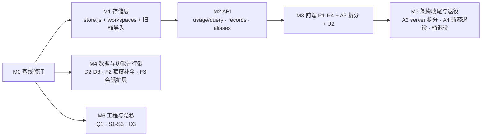

# DoraMonitor 综合改进方案

> 版本:v1.0(2026-10-31)
> 依据:`docs/` 全部 22 篇文档 + 代码现状盘点(2026-10-31)。本方案是全项目范围的改进总纲;专项方案 `[usage-insights-*]` 指 [需求文档](./usage-insights-requirements.md) 与 [改进方案](./usage-insights-improvement-plan.md)(SQLite 行存版 v2.0),不在此重复其细节。

## 0. 执行摘要

项目已完成:九工具采集、CNY 单一账本、日桶聚合、多 Kimi 账号额度、三通道多设备同步、CLI/daemon、npm 发布与双平台安装器。当前的主要矛盾集中在四处:

1. **文档基线与最新决策分叉**:PRD §5.2"不引入数据库"、Node 18+ 承诺,与已定的 SQLite 行存 + Node 22.5+ 路线冲突;
2. **架构重构只做了一半**:refactor-plan 的 P4/P5 逻辑边界已抽出,但 server.js(约 730 行)/App.jsx(1296 行)物理单文件未拆,20 项验收清单全部未勾选;
3. **数据能力落后于功能规划**:预聚合桶无法支撑工作区维度与全历史明细(usage-insights 已给出 SQLite 解法,未实施);价目硬编码带日历驱动的过期点(K2 系列 2026-12 下线);
4. **工程与文档一致性存在遗留问题**:端点数三处对不上、旧路径残留、双写无删除期限、CI 矩阵未随 Node 决策收窄。

改进分五个里程碑(M0-M4),M1 存储层是最大杠杆——它同时解锁用量洞察 R1-R4、全历史明细、工作区维度三块能力,并消化 bucket 层退役。

## 1. M0 基线修订(先做,半天)

所有后续工作的前置——不修基线,方案与 PRD 持续分叉。

| # | 事项 | 依据 |
| --- | --- | --- |
| B1 | **PRD 修订为 v1.1**:§5.2 "不引入数据库"改为"仅允许本机单文件 `node:sqlite`,禁止服务端数据库与原生编译依赖";§7.5 Node 要求改为 22.5+;补 FR-10(工作区维度用量)、FR-11(图表下钻明细)、FR-12(模型三态明细);§10 六项待确认决策逐项落勾 | PRD §5.2/§7.5/§9/§10 ↔ improvement-plan §0/P4 |
| B2 | **Node 口径统一为 22.13+**(node:sqlite 免 flag 下限;22.5-22.12 需 experimental flag):package.json engines、README、deployment.md、development.md CI 矩阵(Node 18/22 → 仅 22)同步修改 | 三处口径分裂 |
| B3 | **兼容字段删除期限落文**:api.md §7 的 `provider` 兼容字段写明删除版本(建议 v2.0),peer 摘要双字段同——满足 PRD 6.3 "不得无限期隐式双写" | api.md §7、data-migration-plan M5 |
| B4 | **FP-02 编号补齐或删除**:future-roadmap FP-01 直接跳 FP-03;refactor-plan 引用的"额外账号归属映射见未来计划"需要有落点 | future-roadmap §2→§4 |
| B5 | **文档一致性清扫**(半天内):architecture.md 数据源 7→9、删"quota.js 唯一外网调用"错句、统一 7d/30d 窗口口径;api.md 端点数与 architecture.md 对齐;`~/.kimicode-dashboard/` 残留路径(privacy/api/configuration 三处)改为 `~/.doramonitor/`;docs/README.md 导航补 usage-insights 两篇与本篇;refactor-plan §7.3 的 ZCode 集成示例换掉(ZCode 不启用额度) | 消化报告 #1/3/4/10/21 |
| B6 | **验收清单补勾**:refactor-plan §14 与 data-migration-plan §14 共 20 项,逐项验证后勾选或降级为"明确放弃",消除"头部称已完成、清单全空"的状态矛盾 | 两文档末尾清单 |

## 2. 架构改进

### A1 存储演进:`node:sqlite` 行存(最大杠杆)

按 usage-insights-improvement-plan v2.0 Phase 1 执行,此处只列架构影响:

- 新增 `src/store.js`(`DatabaseSync`,WAL,`~/.doramonitor/doramonitor.db`):逐请求行存 + `files` stamp 表 + 事件表 + 旧桶 legacy 导入表;
- **适配层策略(低风险关键)**:store 暴露 `bucketView(filter)` 返回 `{usageDays, eventDays}` 形状,现有 `aggregateFromBuckets()`/`ensureAggregates`/`displayCosts`/计价链路**零改动**先用起来;新端点再用直接 SQL;
- 退役清单(分两步,见 A4):`RECORD_WINDOW_DAYS`/`RECORD_CAP`/`RECENT_LIMIT` 立即可退役(全历史可查);`buckets.js` 与 `DORAMONITOR_DISABLE_BUCKETS` 开关在行存稳定一个版本后删除;
- 附带收益:ZCode/QoderCN 的 SQLite 读取改用 `node:sqlite`,移除 sqlite3 CLI 回退路径(deployment.md §1 痛点)。

### A2 server.js 物理拆分(refactor-plan P4 的真正落地)

refactor-plan §6 的目标目录是"P4 的结果",但物理迁移从未发生。按依赖方向分三步,每步独立提交、`npm test` 全绿:

1. `src/http/router.js`:路由注册表替代 if-chain;静态托管与 API 分离;
2. 按域拆处理器:`src/http/routes/{usage,quota,prices,sync,sessions,config,catalog}.js`;现有 `tool-quota-service.js`/`quota-tool.js` 等逻辑服务归入 `src/services/`;
3. `server.js` 瘦身为组装入口(<100 行);development.md §6 "新增 API 在 server.js 路由链中添加"同步改写。

> 刻意不做:不强推四层目录(domain/application/…)的形式化——单用户项目的收益低于搬迁成本,按域拆平即可;这与 refactor-plan 的字面目标有出入,在 B1 修订 PRD 时一并注明。

### A3 前端拆分

App.jsx 1296 行,按 usage-insights P3 的组件拆分顺带完成:`FilterBar`/`HeroCard`/`ChartSection`/`ModelSection`/`DetailSection`/`DayDetailDialog`/`ModelDonut` 落到 `web/src/components/`,App.jsx 保留路由与状态编排(目标 <400 行);筛选状态收敛为单一 reducer。

### A4 兼容层退役时间表

| 兼容物 | 退役条件 | 目标版本 |
| --- | --- | --- |
| `provider` 旧字段(API 响应 + peer 双字段) | **已确认删除**(2026-10-31):三步走——peer 停发双字段 → 端点下线旧请求参数 → 删响应字段,每步独立发布;api.md 已写明该计划 | v2.0 |
| 长程估算退役残留(`mergeLongIntervals`、`longTermTargets`、`estimateKind=long-term` 查询) | 行存落地、quota 页改版(F2)后 | v2.0 |
| 日桶层(`buckets.js`、`BUCKET_TOOLS`、`DORAMONITOR_DISABLE_BUCKETS`) | `usage_daily_legacy` 导入稳定 + 用户确认历史无误 | v2.0 |
| `~/.kimicode-dashboard/` 缓存路径迁移 | 读取旧路径存在则迁移到新路径,一次性 | v1.1 |

## 3. 数据改进

| # | 事项 | 说明 | 依据 |
| --- | --- | --- | --- |
| D1 | 工作区维度 | 随行存落地(`workspace_key` 列 + `workspaces.js` 归一 + kimi `wd_*→workDir` 映射),见 improvement-plan §1.1 | improvement-plan |
| D2 | **去重机制收敛** | 五套机制并存(值签名/response_id/message.id/id\|timestamp/无)。在 store.js 行存上统一为"记录级 `sig` 唯一列 + INSERT OR IGNORE",各采集器只负责产出 sig;解决"同值同时间真实调用被误去重"与"qoder-cn-cli 不去重"两端的正确性风险 | tools.md、limitations §2 |
| D3 | **计价数据外置 + 校准项清偿** | 价目从 pricing.js 硬编码迁到 `src/data/pricing.json`(代码只留匹配/回退逻辑),改价不再改码重启;随版本更新内置快照。同时清偿:K2.8 正式价发布即迁移(当前按 K2.7 计价)、**K2 系列 2026-12 下线前完成价目迁移与测试(日历硬期限)**、`gpt-6.1-sol:flex` 收录、DeepSeek 节假日表参数化年份(不再只认 2026) | pricing §3.1/3.2/3.6/3.7/§6 |
| D4 | 缓存写 TTL 缺失的折衷统一 | Kimi wire 无 TTL、Codex 无 TTL 类型——行存 `cs`/`cl` 列保留 null 语义,计价侧维持"双档平均 + estimated"标记;在价目页为这两类模型显示"TTL 未知按均值估算"脚注,把折衷显性化 | pricing §3.1/3.7 |
| D5 | gemini 采集增强(低优先) | 32MiB outfile 截断改为"多文件轮转检测"或至少文档明示;文档标注"无项目维度为 OTel 源数据限制,行存中归入 `__unknown__`" | tools.md §9、limitations §2 |
| D6 | peer 样本窗口对齐 | 同步只传 35 天额度样本 vs 本地 90 天,对端估算质量不对称;将 quotaUsage 桶传输窗口提到 90 天(或做成可配置),并在 /sync 页显示对端窗口长度 | sync.md §2、quota §7.1 |

## 4. 功能改进

### F1 用量洞察 R1-R4(主线,见专项方案)

R1 视觉升级 / R2 工作区维度 / R3 图表下钻当日明细 / R4 模型三态明细——全部依赖 M1 存储层,按 improvement-plan Phase 2/3 执行。

### F2 额度体系补全

1. **FP-03 其他工具/账号额度扩展**(future-roadmap 唯一"待实施"项):Claude Code(Max/Pro 限额本地不可见,调研是否有可用数据源;不可用则明确停止,不实现无数据支撑的 UI)、ZCode(维持"仅 Token"边界)、Codex 归档 rollout 的 wham/usage 轮询增强;每个集成经由 QuotaIntegrationRegistry 接入,带契约测试;
2. **额外 Kimi 账号等效估算解禁**:前置是账号归属映射(FP-02 落点)——在 D1 行存中 `account` 列已预留,映射规则(会话→账号)确定后,放开 limitations §4.12 的禁用;
3. **调度参数设置化**:1h 窗口/4% 触发/10% 上限/5min 采样从硬编码暴露到设置页(默认值不变),消除 quota §7.5;
4. **额度页信息架构改版**:首页额度卡片只留官方窗口 + 最近一次等效估算摘要(等效人民币 + 95% 命中等效 Token);四档命中率对照、手动测算、历史记录全部收进 /quota 页——降低首页密度,也顺势删除长程兼容查询路径(A4)。

### F3 会话与工具能力扩展

1. 会话管理(归档/预览)从 Kimi Code 扩展到文件型会话工具(claude-code/codex/omp/dsh),复用 sessions.js 的三道闸与脱敏预览;SQLite 类工具只读不写;
2. `deleted_workspace_ids` 写失败静默忽略改为上报到 `meta.errors`(sessions.md §3);
3. `meta.errors` 在 footer 扫描健康行(见 F1-R1)中可见,采集失败不再完全静默。

## 5. UI/UX

| # | 事项 | 说明 |
| --- | --- | --- |
| U1 | R1 设计升级 | hero 卡/统一筛选条/胶囊图例/口径说明条/导出,见专项方案 §3.1 |
| U2 | 四页签顶栏统一 | 用量页与其他页顶部 bar 布局统一为一个共享 `TopBar` 组件(A3 拆分时落地) |
| U3 | 空态与降级文案 | "未知工作区""TTL 未知估算""对端版本旧导致降级"等状态给明确解释文案,而不是留白或数字突降 |
| U4 | 移动端/窄屏抽查 | 卡片流在 <900px 的折行情况过一遍(自用桌面为主,只求不破版) |

## 6. 工程质量

| # | 事项 | 说明 |
| --- | --- | --- |
| Q1 | CI 矩阵收窄 + lint 门禁 | Node 18/22 → 22;引入 eslint(flat config,零插件起步)+ `npm run lint` 入 prepack;现有 `node --test` 保持 |
| Q2 | 行存等价性测试 | improvement-plan §5 的测试矩阵;重点:折叠等价、旧桶导入一致、三态守恒 |
| Q3 | CHANGELOG 机制 | Keep a Changelog 格式,发版脚本从它生成 release notes(release.md 目前无此环节) |
| Q4 | 大文件门禁 | 约定 server.js/aggregate.js/App.jsx 拆分后的行数上限(如 800 行),CI 警告级 |

## 7. 隐私与部署

| # | 事项 | 说明 | 依据 |
| --- | --- | --- | --- |
| S1 | **可选访问令牌** | 现状零鉴权,`--host` 一旦修改即无保护暴露。加 `DORAMONITOR_TOKEN`:设置后所有 `/api/*` 要求 `Authorization: Bearer`,部署到局域网时可用;默认不设置行为不变,文档给"公网暴露仍然不被支持"的红线 | privacy §3、limitations §1 |
| S2 | macOS 安装器 | launchd plist 生成脚本,补齐三平台对齐(linux/windows 已有) | limitations §1 |
| S3 | 后台运行日志 | daemon/web 后台启动时输出重定向到 `~/.doramonitor/logs/` + 简单轮转,替代"改前台定位"的现状 | deployment §6 |
| S4 | WebDAV 加固 | PROPFIND 正则解析 XML 换为受控的 XML 提取(仍可无依赖,但处理转义/命名空间);Local 后端异常锁的主动清理 | sync.md §5 |
| S5 | 配置明文项脚注 | WebDAV 密码、quotaAccounts home 明文本机——privacy.md 已声明,补到 configuration.md 对应字段旁 | configuration §1.1 |

## 8. 文档与发布

- O1:M0/B5 的文档清扫全部完成;
- O2:api.md 补 `/api/usage/*` 三端点契约(improvement-plan P2 交付时强制同步,列为本方案的验收项);
- O3:公开仓库前的最后一道审计:全量 Git 历史敏感信息扫描(用 gitleaks 类工具执行一遍)、`NOTICE`/`LICENSE` 复核(README 显示 npm 已发布,若仓库仍私密则此项在转公开前执行)。

## 9. 路线图与依赖

> **M3.5 SQLite 扩展性加固(2026-10-31 已完成)**:① `PRAGMA user_version` 版本化迁移(MIGRATIONS 数组,追加式);② `src/record-schema.js` 记录契约(字段声明 + validateRecord 入库边界校验 + emptyRecord 单一实现);③ `pricing.cellCostCny` 单一费用计算(aggregate/store 去重);④ 存储端口成文(architecture.md §4.0:五方法唯一边界 + 四条纪律)。验证:272 项测试全绿,真实数据 13.6k 记录零校验误判。
> 说明:曾评估"费用完全推迟到 DTO 组装"——因热力图需要逐日费用而放弃;③ 的"单一费用函数"达成同一目标(改价不动聚合)且无结构震荡。

| 里程碑 | 内容 | 预估 | 关键验收 |
| --- | --- | --- | --- |
| M0 | B1-B6 | 0.5-1 天 | PRD v1.1 提交,文档清单清零 |

> M0 进展(2026-10-31):**B1-B6 全部完成**。
> - B1:PRD 修订为 v1.1(SQLite 追认、Node 22.13+、新增 FR-10/11/12、§10 决策 1/5 落勾);
> - B2:engines `>=22.13`、CI 矩阵 Node 22/24、README(中英)徽标与环境要求、deployment/development/limitations 同步;
> - B3:api.md 写入 `provider` 兼容字段三步删除计划(v2.0);
> - B4:future-roadmap 补 FP-02(额外账号用量归属映射)及优先级表;
> - B5:architecture.md 数据源 7→9、外网调用三类、端点数、7d/30d 窗口口径;configuration.md syncInterval ≥60(代码 `max(60,…)` 为准);`.kimicode-dashboard` 三处加历史路径注;refactor-plan §7.3 示例去 ZCode;docs/README.md 导航补三篇;
> - B6:两份 §14 清单 20 项逐项审查后补勾(证据:npm test 263 项、build、pack dry-run;备注见各清单)。
| M1 | A1 存储层 + D1 + D2 | 2-3 天 | 折叠等价测试全绿,`/api/summary` 输出不变 |
| M2 | A1 的 3 个新端点 + O2 | 1 天 | api.md 同步,全历史 records 可分页 |
| M3 | F1 全部 + A3 + U1/U2/U3 | 3-4 天 | 需求文档三张验收清单勾满 |
| M4 | D3-D6 + F2 + F3 + S4/S5 | 按项独立,随时穿插 | 各项自带验收 |
| M5 | A2 + A4 退役 | 2 天 | server.js <100 行,兼容物删除,CHANGELOG 记录 |
| M6 | Q1 + S1-S3 + O3 | 1-2 天 | CI 单矩阵 + lint 绿;token 可用;三平台安装器齐 |

**建议节奏**:M0 → M1 → M2 → M3 为一条主线不间断执行(约 7-9 天);M4/M6 的独立项穿插在主线间歇;M5 收尾。D3 的 **K2 系列 2026-12 价目迁移是唯一的日历硬期限**,若主线进度拖过 12 月,应优先插入处理该项。

## 10. 风险与对策

| 风险 | 对策 |
| --- | --- |
| M1 行存迁移丢历史 | `buckets/` 改名保留 + `usage_daily_legacy` 导入 + "从桶重新导入"命令;等价性测试作为门禁 |
| A2 拆分引入路由回归 | 三步各自提交;拆分前先补一组路由级冒烟测试(拆分本身也是测试加固) |
| PRD 修订滞后导致方案失去"共同基线"地位 | M0 最先做,PRD v1.1 由本项目所有者(你)确认后合入 |
| F2 的 Claude 额度调研无果 | 按 roadmap 原则"数据源不可用即明确停止",不实现无数据支撑的 UI |
| 同步载荷新增维度破坏 peer 兼容 | 维持"workspace/account 不同步"边界(D1 明确),peer 协议本期不动 |
