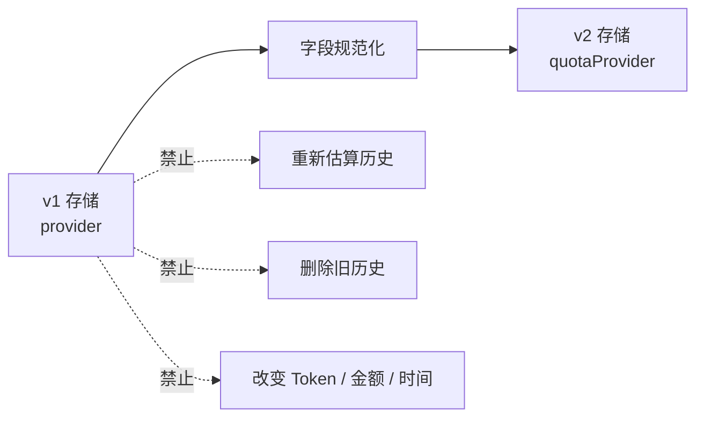
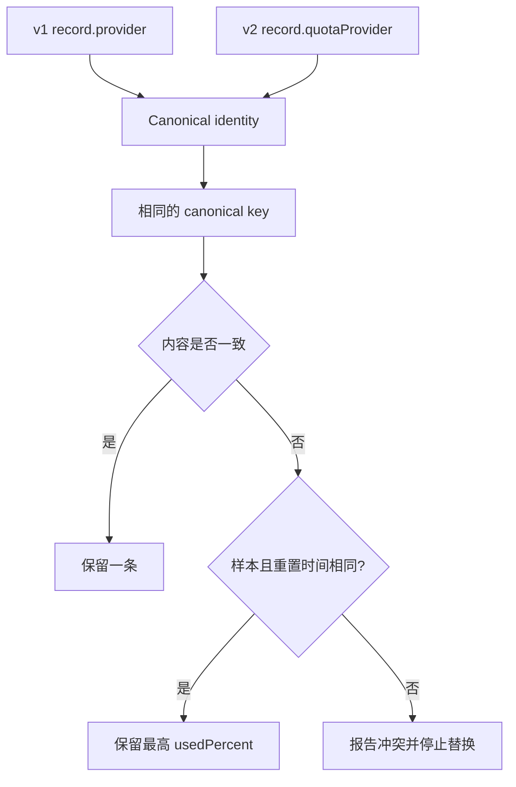
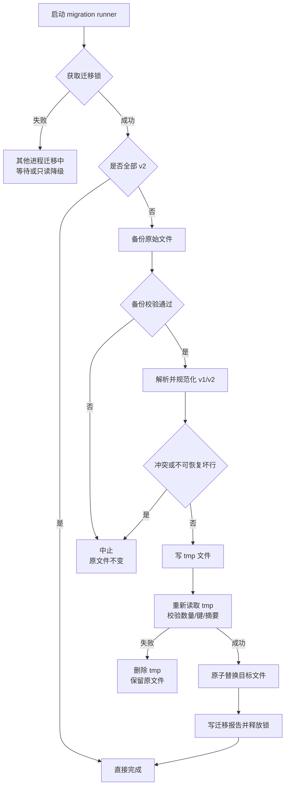
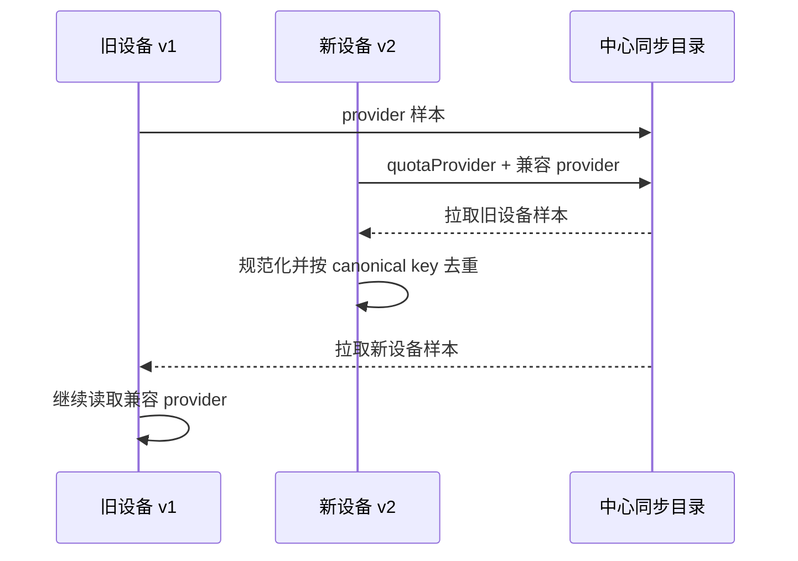
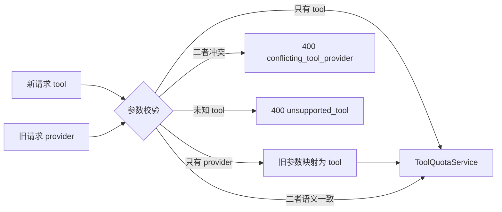
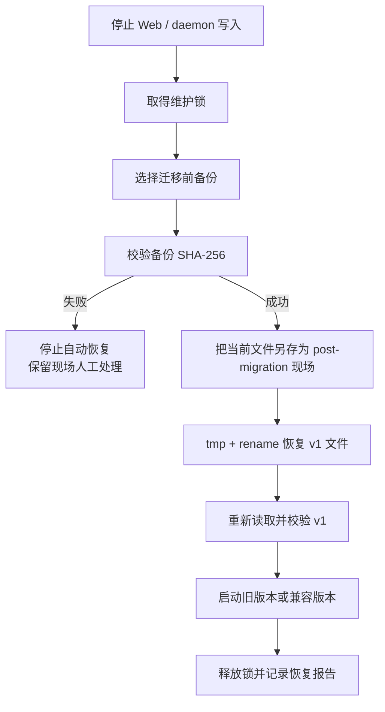

# DoraMonitor 数据兼容迁移方案

> 状态：核心迁移已实现，依据 [项目需求文档](./product-requirements.md) 与 [架构重构方案](./architecture-refactor-plan.md)。
> 验收记录：2026-10-31 对 §14 完成标准逐项完成代码级审查并补勾（证据：npm test 263 项通过、build 与 pack dry-run 通过）；兼容层删除计划见 §13 M5 与 [综合改进方案](./comprehensive-improvement-plan.md) A4。
> 实现位于 `src/quota-schema.js`、`src/quota-migration.js` 和 `src/quota-estimator-store.js`；恢复入口为 `restoreQuotaBackup`。
> 目标：把额度存储中的裸 `provider` 规范化为 `quotaProvider`，公开 API 统一为 `tool`，同时保证旧数据不丢失、历史不重复、调度连续、迁移可回滚。

## 1. 迁移原则与不变量

### 1.1 必须保持不变

- 所有有效样本、历史、最高值、调度锚点和校准状态均可恢复；
- 历史时间、数值、触发原因、签名和观测明细保持原值；
- 既有估算结果不因存储迁移而重新计算；
- 去重键的语义和键字符串尽量保持不变；
- 同一数据重复迁移不会产生重复记录；
- 新旧 peer 在兼容期内可以混合工作；
- 备份失败或迁移冲突时，原文件不被修改。

### 1.2 本次只做契约迁移



本迁移与 `ALGORITHM_VERSION` 完全独立。存储 schema 从 v1 到 v2，不要求算法版本变化；算法升级也不要求再次迁移存储。

## 2. 数据资产与影响范围

| 数据 | 当前位置/形态 | 改动 | 风险 |
| --- | --- | --- | --- |
| 额度样本 | `samples.jsonl`，每行一个 JSON | `provider → quotaProvider`，`version: 2` | 重复样本、坏行、90 天保留 |
| 测算历史 | `history.jsonl` | 字段与版本规范化，其他内容原样保留 | 历史链断裂、重复批次 |
| 状态 | `state.json` | 顶层 version、cache、estimates、calibrations 字段规范化 | 锚点丢失、重复调度 |
| peer 摘要 | 远端 `<device>.json` 与 remote-cache | codec 双读 v1/v2，兼容期双字段输出 | 新旧设备无法互读 |
| API 请求 | query/body 中的 provider | 新参数 tool，旧参数适配 | 旧客户端兼容、参数冲突 |
| 浏览器偏好 | 以额度 provider 构造的展开键 | 读取时映射到 tool，保留旧值 | 用户展开状态丢失 |
| 用量日桶与设置 | days、config.json 等 | 本次不改 | 不得被额度迁移触碰 |

迁移入口不得重写 `config.json`、用量日桶、会话文件或凭据文件。

## 3. v1/v2 契约对照

### 3.1 字段与公开分类

| 场景 | v1 / 旧契约 | v2 / 新契约 | 兼容策略 |
| --- | --- | --- | --- |
| 本地样本、历史、状态 | `provider` | `quotaProvider` | 读取 v1/v2，只写 v2 |
| 公开 API 请求 | `provider` | `tool` | 兼容期接受二者，冲突返回 400 |
| 公开 API 响应 | 顶层/容量中混有 provider | 明确 `tool` | 兼容期保留废弃字段，前端不读 |
| peer quotaSamples | `provider` | `quotaProvider` | 兼容期输出双字段，读取优先 v2 |
| 模型与配置 | `modelProvider`、配置 provider | 保持原语义 | 不参与本次改名 |

### 3.2 样本 v1

```json
{
  "version": 1,
  "provider": "kimi",
  "accountKey": "kimi:default",
  "window": "weekly",
  "sampledAt": "2026-10-30T08:06:02.276Z",
  "usedPercent": 10,
  "resetsAt": "2026-11-06T08:00:00.000Z",
  "source": "kimi-api"
}
```

### 3.3 样本 v2

```json
{
  "version": 2,
  "quotaProvider": "kimi",
  "accountKey": "kimi:default",
  "window": "weekly",
  "sampledAt": "2026-10-30T08:06:02.276Z",
  "usedPercent": 10,
  "resetsAt": "2026-11-06T08:00:00.000Z",
  "source": "kimi-api"
}
```

除上述两个字段外，JSON 值不改变；不得重排时间、取整百分比或重新计算费用。

### 3.4 历史记录

历史条目只做：

- `version` 规范化为 2；
- 顶层 `provider` 改为 `quotaProvider`；
- 保留 `createdAt`、`calculationStartAt`、`calculationEndAt`、`previousCalculationEndAt`；
- 保留 `fullWindowTokens`、`fullWindowCostCny`、`low/high`、`modelMix`、`observations`；
- 保留 `trigger`、`calibrationId`、`signature` 和所有质量字段。

API 输出历史 DTO 时再由应用服务附加 `tool`，而不是把 tool 写回历史存储并制造第二个分类事实来源。

## 4. 规范化与去重策略

### 4.1 唯一规范化入口

```text
canonicalQuotaProvider(row) = row.quotaProvider ?? row.provider
canonicalVersion(row)       = 2
其他字段                    = 原值
```

规则：

- 两个字段都不存在：记录无效，进入迁移错误报告；
- 仅一个字段存在：使用该值；
- 两者相同：接受并只保留 `quotaProvider`；
- 两者不同：视为 `conflicting_quota_provider`，不得静默选择；
- `quotaProvider` 在存储 schema 中是开放字符串，由 QuotaIntegrationRegistry 校验运行时支持能力；未知值进入显式错误/扩展迁移流程，不能默认成 Kimi；
- `accountKey` 是账号隔离的必要字段，新增账号不需要再次修改 schema，也不得把多个账号规范化为 default。

### 4.2 键字符串保持不变

当前键的内容已经是 `kimi/openai` 等账户族值，因此字段改名不要求改变键字符串。

| 键 | 组成 | 迁移策略 |
| --- | --- | --- |
| sampleKey | quotaProvider + accountKey + window + sampledAt + source | 值不变，只换字段访问器 |
| estimateKey | quotaProvider + accountKey + usageScope + estimateKind + window + cacheHitRate | 值不变，保护历史链 |
| capacityKey | quotaProvider + accountKey + usageScope + algorithmVersion | 值不变，算法版本独立 |
| maxima key | 与 estimateKey 同语义 | 原键保留，值对象字段规范化 |
| checkpoint key | standard/long-term + 原账户族值 + account + window | 视为稳定 ID，原样保留 |
| calibration key | 原账户族值 + account + scope + window | 原键保留，值对象字段规范化 |



### 4.3 冲突与重复

- 完全相同的旧新记录：保留一条；
- samples 的 key 相同且 `resetsAt` 相同：额度用量在该周期内应单调增加，保留最高的 `usedPercent`，不依赖文件顺序；
- samples 的 key 相同但 `resetsAt` 不同：可能是跨周期身份冲突，必须中止，不得静默选择；
- history 的 key 相同但内容不同：写入冲突报告并中止对应文件替换；
- history 不去重“看起来相似”的不同批次，只使用 canonical key + createdAt + signature；
- 去重前后数量必须写入迁移报告。

## 5. state.json 迁移细则

### 5.1 顶层

```json
{
  "version": 2,
  "cache": {},
  "estimates": [],
  "maxima": {},
  "checkpoints": {},
  "calibrations": {}
}
```

缺失容器仍按空对象/空数组补齐；未知附加字段原样保留，避免未来字段被旧迁移器删除。

### 5.2 各容器

| 容器 | 必须迁移 | 明确不变 |
| --- | --- | --- |
| cache | value 中的 capacity.provider → quotaProvider | 原 cache key、generatedAt、algorithmVersion、targets 数值 |
| estimates | 每条 estimate 的字段与 version | 原数组顺序、历史和签名 |
| maxima | value 中若存在 provider 则规范化 | 原 key、最高值、createdAt、质量字段 |
| checkpoints | 通常无需改 value | 原 key、anchorAt、anchorPercent、resetsAt、lastRunAt |
| calibrations | value.provider → quotaProvider | 原 key、id、startAt、startUsedPercent、resetsAt |

迁移完成后不得运行一次“补偿测算”，否则可能重复写历史或推进锚点。

## 6. 启动迁移流程

### 6.1 执行位置

- Web 启动时，在 sampler、额度 API 和同步读取之前执行；
- CLI/daemon 若会读写额度数据，也调用同一个 migration runner；
- 所有入口共享同一仓储与锁，不得各自实现迁移；
- 失败时额度功能只读降级，其他用量、价目和会话功能继续可用。

### 6.2 原子流程



### 6.3 锁与中断恢复

- 锁文件：`~/.doramonitor/quota-estimator/migration.lock`；
- 内容包括 pid、hostname、startedAt、fromVersion、toVersion，不含敏感数据；
- 使用独占创建，不能仅“先检查再创建”；
- 进程存活时锁忙，不并发迁移；
- 进程不存在且锁超时后，才允许回收 stale lock；
- tmp 文件带 pid 与随机后缀，启动时清理已确认无主的旧 tmp；
- 替换完成后才写 migration report，报告不是判断原文件完整性的唯一依据；
- 每次启动仍检测实际 schema，保证重复执行幂等。

### 6.4 备份布局

```text
~/.doramonitor/quota-estimator/
  backups/
    v1-to-v2-20261031T153000000Z/
      samples.jsonl
      history.jsonl
      state.json
      manifest.json
      conflicts.jsonl        # 仅发生冲突时
      unparsed-lines.jsonl   # 仅有坏行时
```

`manifest.json` 记录原文件大小、SHA-256、记录数、创建时间和应用版本。备份文件必须重新读取并校验摘要，不能仅依赖 `copyFile` 返回值。

## 7. JSONL 坏行与文件故障处理

| 情况 | 处理 |
| --- | --- |
| 空行 | 忽略，不视为记录 |
| 最后一行明显截断 | 原文件完整保留在备份；截断内容写入 unparsed-lines；迁移有效行并报告警告 |
| 中间存在无法解析的非空行 | 中止该文件替换，保留原文件并报告行号 |
| 单行字段冲突 | 中止对应文件替换，报告 canonical key 和行号 |
| 某条记录缺少必要身份字段 | 中止对应文件替换，不默认成其他账户族 |
| 文件不存在 | 视为空 v2 数据集，不创建虚假历史 |
| 权限不足 | 备份或写入失败，原文件不变，额度只读降级 |
| tmp 校验数量不一致 | 删除 tmp，中止迁移 |

迁移报告可以包含行号、键和数量，但不得包含凭据或会话正文。

## 8. 写入、读取与校验顺序

### 8.1 单文件原子替换

1. 所有 v1/v2 输入先在内存中流式规范化；
2. 写同目录 tmp，避免跨文件系统 rename；
3. flush 并关闭文件；
4. 重新读取 tmp，检查 schema、canonical key 和记录数；
5. 先确认备份摘要，再 rename 替换；
6. 任一目标失败时保留其他原文件的备份，按报告执行恢复。

Windows 与 POSIX 的 rename 差异必须封装在同一个 atomic-write helper 中，并复用现有 state 写入约定；不能在迁移脚本里另写一套未经测试的替换逻辑。

### 8.2 迁移后校验

- version 全部为 2；
- 有效记录中不再存在裸 provider；
- canonical key 集合与迁移前一致；
- 历史 createdAt/endAt/signature 摘要一致；
- checkpoints 与 calibrations 的 key 集合一致；
- cache algorithmVersion 与生成时间不变；
- 再次运行迁移返回 `already_migrated`，文件摘要不变化。

## 9. peer 与同步兼容

### 9.1 为什么不能只改本地文件

不同设备可能运行不同版本。若新端立即只发送 `quotaProvider`，旧端会无法识别额度样本；若新端不能读旧字段，则旧端数据会被漏掉。

### 9.2 兼容期策略

| 方向 | 行为 |
| --- | --- |
| 读取 v1 peer | 从 provider 规范化，继续参与合并 |
| 读取 v2 peer | 优先 quotaProvider，忽略兼容 provider |
| 两字段一致 | 接受并按 canonical key 去重 |
| 两字段冲突 | 该样本标记无效并记录设备/行位置，不影响其他样本 |
| 兼容期发送 | summary version 2，quotaSamples 同时带 quotaProvider 和废弃 provider |
| 下一 major | summary 升级并停止发送 provider，文档明确最低 peer 版本 |



remote-cache 可以保存原始 peer 文档；读取 codec 在内存中规范化，不要求改写其他设备上传的原件。

## 10. API 与前端兼容

### 10.1 请求适配



### 10.2 响应兼容

- 新响应始终包含顶层 `tool`；
- 历史与样本 DTO 由应用层从 quotaProvider 反推出 tool；
- 兼容期可以保留 `provider`/`capacity.provider` 供旧客户端读取，但必须标记 deprecated；
- 新前端只使用 tool，不得继续读取废弃字段；
- 下一 major 删除兼容字段前更新 API 版本说明和迁移指南。

### 10.3 浏览器偏好

旧展开键中的 `kimi/openai` 读取时分别映射到 `kimi-code/codex`。新键写 tool；成功读取新键后可清理旧键，但不影响任何用量或额度数据。

## 11. 回滚方案

### 11.1 回滚触发条件

- 迁移后记录数、canonical key 或历史摘要不一致；
- 旧客户端无法读取兼容响应；
- 新旧 peer 混合产生重复或丢失；
- 调度锚点异常导致重复历史；
- 任何无法解释的数据损坏。

### 11.2 恢复流程



不得在恢复前删除备份，不得只恢复 state 而保留不匹配的 samples/history。三份文件应来自同一个备份批次。

## 12. 测试矩阵

### 12.1 仓储与迁移

| 用例 | 预期 |
| --- | --- |
| 纯 v1 samples/history/state | 全部迁移为 v2，值与键不变 |
| 纯 v2 | 返回 already_migrated，摘要不变化 |
| v1/v2 混合且完全重复 | 只保留一条 |
| 样本同 key、同重置周期、百分比不同 | 保留最高 usedPercent |
| 样本同 key、重置周期不同 | 冲突并中止，原文件不变 |
| history 同 key 不同内容 | 冲突并中止，原文件不变 |
| provider/quotaProvider 同值 | 接受并规范化 |
| 两字段冲突 | 拒绝该记录并中止对应文件 |
| 空文件、缺失文件 | 正常处理，不创建虚假历史 |
| 最后一行截断 | 备份并报告，迁移有效行 |
| 中间坏行 | 中止并保留原文件 |
| 备份目录不可写 | 不修改任何原文件 |
| tmp 写入/校验失败 | 原文件不变，可重试 |
| 连续执行两次 | 第二次无写入、无重复 |
| 两个进程同时启动 | 只有一个执行迁移，另一个等待或只读 |
| state 锚点和校准 | key、时间和百分比完全连续 |

### 12.2 API 与同步

- tool-only 新请求得到正确工具数据；
- provider-only 旧请求在兼容期得到等价数据；
- tool/provider 一致时成功，冲突时 400；
- 未知工具返回 400，不默认成 Kimi；
- v1 peer + v2 peer 合并无重复；
- 旧端能读取新端兼容 provider；
- 新端能读取旧端 provider；
- 单个 peer 坏样本不影响其他 peer；
- 历史分页、计算链和观测明细与迁移前一致。

### 12.3 回归门禁

```bash
npm test
npm run build
npm pack --dry-run
```

另使用临时目录中的 v1 fixture 实际执行 migration runner，再启动应用验证旧历史、采样、校准和调度，不仅测试字段转换函数。

## 13. 分阶段上线

| 阶段 | 行为 | 兼容风险 |
| --- | --- | --- |
| M0 只读准备 | 加入 canonical normalizer、schema 和 fixture，不改写 | 无 |
| M1 双读 | 仓储/API/peer 能读 v1/v2，仍写 v1 | 低，可完整回退 |
| M2 API tool | 前端改传 tool，旧 provider 由适配层处理 | 低，不改本地数据 |
| M3 自动迁移 | 启动备份并写 v2；本地只写 quotaProvider | 中，依赖故障与回滚测试 |
| M4 peer 兼容输出 | 兼容期发送双字段，混合设备演练 | 中，验证旧端读取 |
| M5 清理 | v2.0 删除旧 API/peer 字段（顺序：peer 双字段 → 请求参数 → 响应字段，见 [综合改进方案](./comprehensive-improvement-plan.md) A4） | 需版本公告 |

M1 与 M2 可以先发布，确认稳定后再启用 M3；不要首次发布就同时改字段、改算法并删除旧兼容层。

## 14. 迁移完成标准

- [x] v1 数据全部可读取，v2 数据字段符合契约；（quota-migration.test.js v1 fixture 逐字段断言）
- [x] 迁移备份、报告、锁与恢复流程经过真实故障测试；（备注：单测覆盖锁冲突、篡改备份拒绝恢复、冲突中止三类故障注入；断电/多进程并发/磁盘写满级别的物理演练未执行，作为 v2.0 发布前人工项保留）
- [x] 重复迁移无写入、无重复、无摘要变化；（二次迁移前后三文件字节级 deepEqual）
- [x] 历史数量、时间链、签名和估算值完全保持；
- [x] 最高值、调度锚点和校准状态连续；
- [x] 新旧 API 与 peer 在兼容期内互通；（quota-tool 新旧参数等价/冲突 400 + local-sync v1/v2 对端互通）
- [x] 前端不再依赖 provider 分类；（web/src 额度面纯 tool 驱动，grep 无 capacity.provider 读取）
- [x] 旧配置、用量日桶、会话与凭据文件未受影响；（备注：按迁移代码范围判定——quota-migration.js 仅读写 ~/.doramonitor/quota-estimator/ 下三个文件，物理上不触及其他路径）
- [x] 文档明确兼容期、回滚方法和下一 major 清理计划；（§11 回滚、§12 测试矩阵、§13 M5 清理行；删除版本已定为 v2.0）
- [x] 全量测试、构建和发布 dry-run 通过。（2026-10-31：npm test 263 项通过，npm run build 与 npm pack --dry-run v1.0.2 通过）
