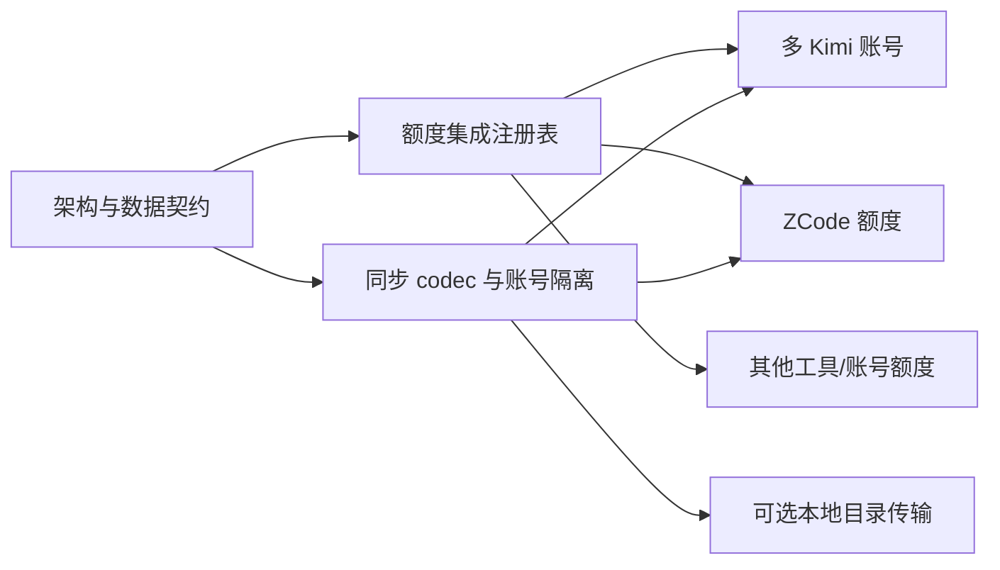

# DoraMonitor 未来功能计划

> 状态：规划草案。本文记录项目所有者提出的后续需求，不表示当前版本已经实现。
> 实施必须遵循 [PRD](./product-requirements.md)、[目标架构](./architecture-refactor-plan.md) 和 [数据迁移方案](./data-migration-plan.md)。

## 1. 规划原则

- 先完成工具、账号和额度集成边界，再增加具体账号与工具；
- 新能力不得破坏现有用量、历史、隐私和多设备同步；
- 官方额度、推测容量和不可用状态必须明确区分；
- 多账号数据必须全程隔离，不能只在 UI 上复制卡片；
- 每项未来需求都有独立验收条件，可分阶段交付。

## 2. FP-01：多 Kimi 账号额度监控

### 需求

- 同一台机器可配置并监控两个或更多 Kimi 账号；
- 前端仍按 Kimi Code 工具分组，在组内切换个人、工作等账号；
- 每个账号有稳定匿名 `accountKey` 与本机 label；
- 官方额度、采样、历史、最高值、缓存、校准和调度锚点按账号隔离；
- 多设备同步样本保留 accountKey，不能在 peer 合并时变成 default；
- 账号 home/profile/凭据引用仅保存在本机适配层，不上传、不出现在公开 DTO 中。

### 账号归属规则

- 能确定用量账号时，只计入对应用量与估算；
- 不能确定时必须标记 `unknown_account`；
- 不得把两个账号的 Token 合并后分别生成高置信度结果；
- 跨设备同一 accountKey 可表示同一逻辑账号，但需明确的账号映射配置，不能仅凭显示名猜测。

### 验收

- 两个账号可同时采样，窗口和重置互不影响；
- 一个账号刷新或凭据失败不影响另一个账号；
- 历史、校准和调度键均包含 accountKey；
- 账号 label 改变不会重写或复制历史；
- 未知账号归属不会被计入高置信度估算。

## 3. FP-02：ZCode 额度功能

### 需求

- 在现有 ZCode 用量采集之上增加独立 `ZCodeQuotaIntegration`；
- 支持 ZCode 账号发现、额度快照读取、窗口展示和错误状态；
- 根据真实产品能力声明额度窗口、重置规则、估算和校准能力；
- 若存在多个 ZCode 账号，复用与 Kimi 相同的 accountKey 隔离机制；
- 若没有可靠额度数据，不允许伪造额度或容量结果。

### 实施前置调研

- ZCode 是否提供官方额度 API、本地快照或可用订阅数据；
- 窗口类型、重置语义和账号标识；
- ZCode 用量记录能否稳定归属到额度账号；
- 官方条款和隐私边界是否允许读取对应元数据。

### 验收

- 不修改 Kimi/Codex 集成即可接入；
- `tool=zcode&accountKey=...` 可完成账号、额度与历史查询；
- 非 5h/7d 窗口不会被强行映射为 session/weekly；
- 不支持估算时仅展示官方额度，不显示虚构估算卡片。

## 4. FP-03：其他工具与账号的额度扩展

### 需求

- 新工具通过 QuotaIntegrationRegistry 注册，不在应用服务中追加工具判断分支；
- 一个工具可对应多个账号，一个额度账户族也可对应多个工具；
- 每种集成声明 capabilities、窗口、账号发现与快照规范化；
- 用量采集、模型定价、额度归属和公开 DTO 保持独立；
- 新集成必须带契约测试、错误降级和文档。

### 验收

使用一个假想集成验证：只增加集成、注册和测试，不改 HTTP 路由结构、前端分类模型、其他额度客户端及历史 schema。

## 5. FP-04：多设备同步能力保持与增强

### 当前能力必须保留

- SSH/SCP 与 WebDAV 两种中转方式；
- 日粒度用量、一分钟额度用量桶、额度样本和覆盖水位；
- 对端摘要缓存与离线降级；
- Windows ↔ Windows、Windows ↔ Linux、Windows ↔ WSL 等跨环境同步；
- 普通看板请求不联网，只读取本地 remote-cache；
- 不同步提示词、代码、项目名、会话正文或凭据。

### 新架构下的增强

1. `SyncTransport` 只负责上传、列举和下载，不理解额度算法；
2. `PeerSummaryCodec` 负责 v1/v2 编解码、字段规范化和错误隔离；
3. `DeviceIdentity` 检查 deviceName 冲突，避免 Windows/WSL 默认同名覆盖；
4. 多账号样本按 device + tool + accountKey + window 保留身份；
5. 账号未知的用量不能被 peer 合并机制“自动认领”；
6. 同步状态展示最近成功时间、peer、缓存状态和可理解的错误；
7. 新旧版本设备在兼容期内继续混合工作。

### 可选后续：同一机器 Windows/WSL 本地目录传输

当前 Windows/WSL 仍通过 SSH 或 WebDAV 中转。未来可以增加 `LocalDirectoryTransport`：

- 两端都能访问一个明确的本地共享目录；
- 复用现有摘要、codec、去重、缓存和安全约束；
- 不开放端口，不需要公网服务器；
- 只作为 SyncTransport 的新实现，不改变领域和页面；
- 必须处理 Windows/WSL 路径映射、原子写入和 deviceName 唯一性。

该选项是规划项，不是当前已实现的直连或 P2P 功能。

## 6. FP-05：同步拓扑与运维体验

### 计划改进

- 配置页明确选择 SSH、WebDAV 或未来的 Local Directory；
- 启动时检查 deviceName 是否为空或与已知 peer 冲突；
- 提供连接测试和最近一次成功同步状态，但不自动操纵用户浏览器验收；
- 文档给出不同机器、同一机器 Windows/WSL 的配置示例；
- 中转不可用时继续读取本地缓存，并明确数据可能过期。

### 非目标

- 不强制实现设备间 P2P 直连；
- 不要求用户部署 DoraMonitor 中心计算服务；
- 不同步原始会话、凭据或多账号本地 profile 密钥；
- 不通过自动合并解决无法确定的账号冲突。

## 7. 建议优先级

| 优先级 | 项目 | 原因 |
| --- | --- | --- |
| P0 | 架构边界、存储契约与同步 codec | 所有后续能力的基础 |
| P1 | 多 Kimi 账号 | 直接验证 accountKey 和归属隔离设计 |
| P1 | ZCode 额度调研与集成 | 验证新工具无需复制架构 |
| P1 | deviceName 冲突检测与同步状态 | 避免 Windows/WSL 数据覆盖 |
| P2 | 其他工具/账号额度 | 在两类集成验证后推广 |
| P2 | Local Directory Transport | 优化同机 Windows/WSL，不是跨机器同步的前提 |

每个优先级项独立提交和验收；调研确认数据源不可用时，应明确停止对应集成，而不是用不可靠数据补 UI。
